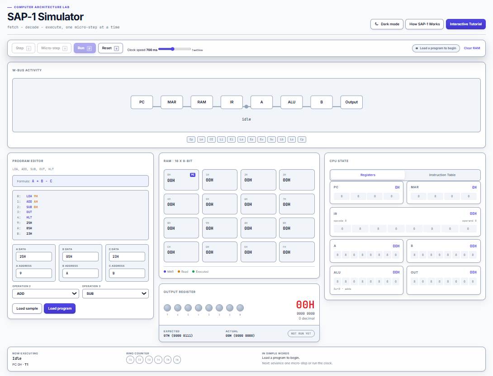

# SAP-1 Simulator

A web-based simulator of the SAP-1 (Simple-As-Possible 1) computer. It visualizes the registers, W-Bus, RAM, control signals and output LEDs in the browser while running SAP-1 machine language programs through the fetch-decode-execute cycle. It was built for Computer Architecture and Organization.



## Table of Contents

- [1. Language and Web Framework](#1-language-and-web-framework)
- [2. Installation and Running](#2-installation-and-running)
- [3. Demonstration](#3-demonstration)
- [4. Features](#4-features)
- [5. How to Use](#5-how-to-use)
- [6. SAP-1 Architecture](#6-sap-1-architecture)
- [7. Sample Programs](#7-sample-programs)
- [8. Project Structure](#8-project-structure)
- [9. Testing](#9-testing)
- [10. Team Members](#10-team-members)
- [11. Acknowledgments](#11-acknowledgments)

## 1. Language and Web Framework

- **Language:** JavaScript (JSX)
- **Framework:** React `^19.3.1`, built with Vite `^8.3.5`

### Justification

- **Component-based UI:** Each part of the SAP-1 block diagram (PC, MAR, IR, Accumulator, B Register, Output Register, RAM viewer, output LEDs, controls) is its own React component. The code therefore mirrors the architecture diagram.
- **Reactive state:** The simulator state is held in a single reducer (single source of truth). Every micro-step updates the CPU state, and React re-renders the registers, RAM highlights, Instruction Table, W-Bus and LEDs automatically, so the display is always in sync with the logic.
- **Fast tooling:** Vite provides a quick development server and a production build.
- **Browser-only:** The simulator runs entirely in the browser with no backend, and uses real graphical components (buttons, panels, LEDs), not a terminal interface.

### Dependencies

| Package     | Version   | Purpose                                     |
| ----------- | --------- | ------------------------------------------- |
| `react`     | `^19.3.1` | UI components and stateful rendering        |
| `react-dom` | `^19.3.1` | Mounts the React application in the browser |

### DevDependencies

| Package                       | Version    | Purpose                                    |
| ----------------------------- | ---------- | ------------------------------------------ |
| `@eslint/js`                  | `^10.0.1`  | ESLint JavaScript configuration            |
| `@types/react`                | `^19.3.0`  | React type definitions used by tooling     |
| `@types/react-dom`            | `^19.3.0`  | React DOM type definitions used by tooling |
| `@vitejs/plugin-react`        | `^6.1.2`   | React support for Vite                     |
| `eslint`                      | `^10.13.0` | JavaScript linting                         |
| `eslint-plugin-react-hooks`   | `^7.1.1`   | React Hooks lint rules                     |
| `eslint-plugin-react-refresh` | `^0.5.7`   | React Refresh lint support                 |
| `globals`                     | `^17.13.0` | Global environment definitions for ESLint  |
| `vite`                        | `^8.3.5`   | Development server and production bundler  |
| `vitest`                      | `^5.0.5`   | Unit test runner                           |

## 2. Installation and Running

### Prerequisites

- Node.js 20.19+ or 22.12+ (required by Vite 8)
- npm (included with Node.js)
- A modern web browser (Chrome, Firefox or Edge)

### Install dependencies

```bash
git clone <repo-url>
cd <project-folder>
npm install
```

### Run the application

```bash
npm run dev
```

Open the local URL printed in the terminal, usually `http://localhost:5173`.

### Production build (optional)

```bash
npm run build
npm run preview
```

## 3. Demonstration

**Recorded demo:** [https://drive.google.com/file/d/1TTvvuxNoxbf-xplovyU0lmzbBWFJKG9u/view?usp=sharing]

The demo shows the simulator computing three different formulas, with the values typed in by the user and each result shown on the 8-LED output display:

| #   | Formula         | Result | LEDs        |
| --- | --------------- | ------ | ----------- |
| 1   | 25H + 05H - 23H | `07H`  | `0000 0111` |
| 2   | 12H + 08H       | `1AH`  | `0001 1010` |
| 3   | 20H - 07H       | `19H`  | `0001 1001` |

## 4. Features

- **Form-based Program Editor** with A, B and C data fields, A, B and C address fields, and two operation dropdowns (`ADD` or `SUB`). The formula (for example `A + B - C`) and the generated program preview update live as the user edits any field.
- **Input validation:** addresses must be `0H` to `FH`, must not overlap each other or the program area, and data must be `00H` to `FFH`. Invalid input shows an inline error and disables **Load program**.
- **Adaptive values:** nothing on screen is hard-coded. The Expected value, Instruction Table, RAM captions, "Now executing" text and Output Register are all derived from the loaded program and the live CPU state.
- **Expected / Actual check** with a status badge: `PENDING` (shown from loading until the program halts, so a program that has not run is never reported as wrong), then `MATCH` or `MISMATCH` once `HLT` is reached. Expected is computed from the entered data and operations (8-bit, wraps at `00H` to `FFH`) and shown in hex and binary.
- **Instruction Table** (address, decoded instruction, 8-bit machine code):
  - It stays hidden until the program is started, then appears automatically when **Step**, **Micro-step** or **Run** is pressed. The user can switch back to the **Registers** tab at any time, and **Reset** returns to it.
  - It updates live when the editor values change. Unused rows are left blank.
  - `OUT` and `HLT` use `1111` as the lower 4 bits (`1110 1111` and `1111 1111`).
- 16 x 8-bit RAM viewer with current-address, read and executed-address highlights. Unused cells stay blank. Instruction cells are marked **Executed** once they have run, while data cells are only marked **Data** (or **Read** while the CPU is reading them), because data is read and never executed.
- Separate panels for PC, MAR, IR (split into opcode and operand), Accumulator, B Register, ALU and Output Register, with values in binary and hexadecimal.
- **W-Bus activity** driven by the current micro-operation: one transfer, in one direction (source to destination), once per T-state, with the active control signal chips highlighted only during the T-state that uses them. No looping animation, and it shows `idle` when stopped or halted. Animation timing follows the clock speed. The bus is 8 bits wide, so 4-bit addresses and operands appear on it with the upper 4 bits as zeros (for example `8H` is shown as `08H`).
- Eight output LEDs showing the Output Register in binary.
- Ring counter display for T1 through T6. `LDA`, `ADD`, `SUB` and `OUT` cycle through all six T-states, including T6 as a NOP when the instruction has nothing to do in it. `HLT` stops the clock at T4, so the ring counter stays on T4 after the program finishes. After **Reset** the ring counter shows T1 as ready.
- Controls: `Load program`, `Load sample program`, `Step`, `Micro-step`, `Run`, `Pause`, `Reset` and `Clear RAM`.
- Clock speed slider from 100 ms to 1500 ms.
- Responsive layout for desktop (three columns, single screen), tablet (below 1200px, two columns) and mobile (below 768px, stacked panels with a sticky control bar).

## 5. How to Use

1. In **Program Editor**, enter the **A, B and C data** values (hex, with or without `H`) and the **A, B and C addresses** (`0` to `F`), then choose **Operation 2** and **Operation 3** (`ADD` or `SUB`). The formula and program preview update as you type.
2. Optionally click **Load sample program** to fill in the sample values.
3. Click **Load program** to copy the generated program into RAM.
4. Run the program:
   - **Micro-step** advances one T-state.
   - **Step** completes one instruction. For `LDA`, `ADD`, `SUB` and `OUT` it ends at T6, and for `HLT` it ends at T4.
   - **Run** advances automatically until `HLT`, and changes to **Pause** while running. When `HLT` is reached the clock stops at T4 and the status shows **Halted**. **Step** and **Run** do nothing after that until **Reset** is pressed.
   - The first time you press any of these, the right panel switches to the **Instruction Table**. Click **Registers** to switch back.
5. Adjust the **Clock speed** slider to change the automatic run speed.
6. Watch the W-Bus, control signals, RAM highlights, registers, Instruction Table and T1-T6 ring counter update.
7. Read the result in the **Output Register** and its eight LEDs, and compare **Expected** with **Actual**. The badge changes from `PENDING` to `MATCH` (or `MISMATCH`) when the program halts.
8. Click **Reset** to clear the registers while keeping the loaded program. The ring counter returns to T1 (ready) and the bus, registers and LEDs are cleared, even if Reset is pressed in the middle of an instruction. Click **Clear RAM** to remove the program. To change values, edit the fields and load the program again.

## 6. SAP-1 Architecture

### Components

| Component                     | Size         | Role                                                                               |
| ----------------------------- | ------------ | ---------------------------------------------------------------------------------- |
| PC (Program Counter)          | 4 bits       | Selects the next RAM address and increments after each fetch.                      |
| MAR (Memory Address Register) | 4 bits       | Holds the RAM address being accessed.                                              |
| RAM                           | 16 x 8 bits  | Stores instructions and data at addresses `0H` through `FH`.                       |
| IR (Instruction Register)     | 8 bits       | Holds the fetched byte; upper 4 bits are the opcode, lower 4 bits are the operand. |
| Accumulator (A)               | 8 bits       | Holds the primary operand and the ALU result.                                      |
| B Register                    | 8 bits       | Holds the second operand for `ADD` and `SUB`.                                      |
| Adder/Subtractor              | 8-bit result | Adds or subtracts A and B using 2's complement; `Su` selects subtraction.          |
| Output Register               | 8 bits       | Receives A during `OUT` and drives the eight output LEDs.                          |
| Controller-Sequencer          | T1-T6        | Decodes the instruction and generates the control signals for each T-state.        |

### Instruction set

| Instruction | Opcode | Function                                                         |
| ----------- | ------ | ---------------------------------------------------------------- |
| `LDA`       | `0000` | Load Accumulator from memory.                                    |
| `ADD`       | `0001` | Add memory value to Accumulator.                                 |
| `SUB`       | `0010` | Subtract memory value from Accumulator (result wraps to 8 bits). |
| `OUT`       | `1110` | Output Accumulator value.                                        |
| `HLT`       | `1111` | Halt execution.                                                  |

The controller decodes only the upper 4 bits (opcode). For `OUT` and `HLT` the lower 4 bits are unused and are written as `1111`.

### T-states and control signals

`LDA`, `ADD`, `SUB` and `OUT` cycle through all six T-states (T1 to T6), then the ring counter returns to T1. `HLT` runs T1 to T3 (fetch) and stops the clock at T4, so T5 and T6 never occur and the ring counter stays on T4.

| T-state | Phase   | Control signals                                                        | Operation                                                            |
| ------- | ------- | ---------------------------------------------------------------------- | -------------------------------------------------------------------- |
| T1      | Fetch   | `Ep`, `Lm`                                                             | PC places its address on the W-Bus and MAR loads it.                 |
| T2      | Fetch   | `Cp`                                                                   | PC advances to the next 4-bit address.                               |
| T3      | Fetch   | `CE`, `Li`                                                             | RAM places the selected byte on the W-Bus and IR loads it.           |
| T4      | Execute | `Ei`, `Lm` for `LDA`/`ADD`/`SUB`; `Ea`, `Lo` for `OUT`; none for `HLT` | The operand loads MAR, A loads OUT, or HLT stops the clock.          |
| T5      | Execute | `CE`, `La` for `LDA`; `CE`, `Lb` for `ADD`/`SUB`; NOP for `OUT`        | RAM loads A for `LDA`, or B for `ADD`/`SUB`.                         |
| T6      | Execute | `Eu`, `La` for `ADD`; `Eu`, `La`, `Su` for `SUB`; NOP for `LDA`/`OUT`  | The ALU returns the result to A and the instruction cycle completes. |

## 7. Sample Programs

The values below are entered by the user through the Program Editor. They are not hard-coded. Each program uses the form `LDA A`, then Operation 2 with B, then Operation 3 with C, then `OUT` and `HLT`.

### Program 1: 25H + 05H - 23H

Editor values:

| Field            | Value         |
| ---------------- | ------------- |
| A data / address | `25H` / `9`   |
| B data / address | `05H` / `A`   |
| C data / address | `23H` / `B`   |
| Operation 2 / 3  | `ADD` / `SUB` |

Generated program:

```text
0: LDA 9
1: ADD A
2: SUB B
3: OUT
4: HLT
9: 25H
A: 05H
B: 23H
```

| Address | Instruction | Machine code |
| ------- | ----------- | ------------ |
| `0H`    | `LDA 9H`    | `0000 1001`  |
| `1H`    | `ADD AH`    | `0001 1010`  |
| `2H`    | `SUB BH`    | `0010 1011`  |
| `3H`    | `OUT`       | `1110 1111`  |
| `4H`    | `HLT`       | `1111 1111`  |
| `9H`    | `DATA 25H`  | `0010 0101`  |
| `AH`    | `DATA 05H`  | `0000 0101`  |
| `BH`    | `DATA 23H`  | `0010 0011`  |

**Expected output:** `07H` (`0000 0111`)

**Expected state after Run:** ring counter on T4, PC = `5H`, IR = `FFH`, A = `07H`, Output Register = `07H` (LEDs `00000111`), status **Halted**, badge `MATCH`.

The W-Bus values for each T-state of this program:

| Instruction | T1   | T3    | T4          | T5    | T6    |
| ----------- | ---- | ----- | ----------- | ----- | ----- |
| `LDA 9H`    | `0H` | `09H` | `9H` (MAR)  | `25H` | idle  |
| `ADD AH`    | `1H` | `1AH` | `AH` (MAR)  | `05H` | `2AH` |
| `SUB BH`    | `2H` | `2BH` | `BH` (MAR)  | `23H` | `07H` |
| `OUT`       | `3H` | `EFH` | `07H` (OUT) | idle  | idle  |
| `HLT`       | `4H` | `FFH` | halt        | -     | -     |

T2 is the PC increment (`Cp`) and uses no bus transfer. Addresses and operands use the lower 4 bits of the 8-bit bus.

### Program 2: 12H + 08H

Set A = `12H`, B = `08H`, C = `00H`, with Operation 2 = `ADD` and Operation 3 = `ADD` (adding `00H` does not change the result).

**Expected output:** `1AH` (`0001 1010`)

### Program 3: 20H - 07H

Set A = `20H`, B = `07H`, C = `00H`, with Operation 2 = `SUB` and Operation 3 = `ADD` (adding `00H` does not change the result).

**Expected output:** `19H` (`0001 1001`)

## 8. Project Structure

```text
src/
├── App.jsx                 # Simulator dashboard, editor, controls, panels, and modals
├── App.css                 # Dashboard, panel, responsive, and animation styles
├── index.css               # Global typography, colors, and focus styles
├── main.jsx                # React application entry point
├── assets/
│   ├── hero.png            # Project image asset
│   ├── react.svg           # React asset
│   └── vite.svg            # Vite asset
├── hooks/
│   └── useSap1.js          # Reducer-backed simulator state and run clock
└── sap1/
    ├── cpu.js              # CPU state, loading, reset, micro-steps, and instructions
    ├── instructions.js     # Opcodes, control signals, decoding, and formatting
    ├── parser.js           # Program Editor input parsing and validation
    ├── presets.js          # Sample program values for the editor
    ├── sap1.test.js        # Vitest tests for CPU and parser behavior
    └── utils.js            # 4-bit/8-bit masking, binary, hexadecimal, and parsing helpers
```

## 9. Testing

```bash
npm test
```

The Vitest suite covers:

- the sample program result and halt behavior
- 8-bit subtraction underflow
- 4-bit program-counter wraparound
- `OUT` and `HLT` behavior
- malformed editor input validation

### Manual verification checklist

Run these in the browser after any change to the CPU or display code:

1. Load the sample program and press **Run**. The ring counter must stop on **T4**, with PC = `5H`, IR = `FFH`, A = `07H`, Output = `07H`, status **Halted**, and badge `MATCH`.
2. Press **Step** and **Run** again after the halt. Nothing should change.
3. Press **Reset**. The ring counter shows T1 as ready, and the bus, registers and LEDs clear. Repeat the Reset in the middle of an instruction (for example at T4).
4. Press **Step** once on `LDA`. It must end at T6 with PC = `1H`. Repeat for `ADD`, `SUB` and `OUT`.
5. Use **Micro-step** through one full instruction and compare the W-Bus value at each T-state with the table in section 7.
6. Before pressing Run, the badge must say `PENDING`, not `MISMATCH`.
7. Data cells (for example `9H`) must show **Data** or **Read**, never **Executed**.
8. Test other values: `10H + 20H - 05H` gives `25H`, and `05H - 10H` gives `F5H` (2's complement).
9. Change an address (for example from `8` to `9`), press **Load program**, and confirm the data moves and the old cell returns to `00H`.

## 10. Team Members

| Name                             | Role                                                |
| -------------------------------- | --------------------------------------------------- |
| Cabuhat, Dave Ronald G.          | Documentation and demo video                        |
| Carreon, Dustin Howell S.        | Project lead and GUI: dashboard, W-Bus, and ALU     |
| Dela Cruz, Christian Lance C.    | CPU logic: registers, LEDs and controller-sequencer |
| Panganiban, Nelson DC.           | Testing and QA                                      |
| Tudlasan, Jhon Marvic Vincent C. | UI/UX Designer, Decoder                             |

## 11. Acknowledgments

- **Course:** Computer Architecture and Organization
- **Instructor:** Madelyn Adelaida B. De Guzman
- **Reference:** Malvino and Brown, _Digital Computer Electronics_
